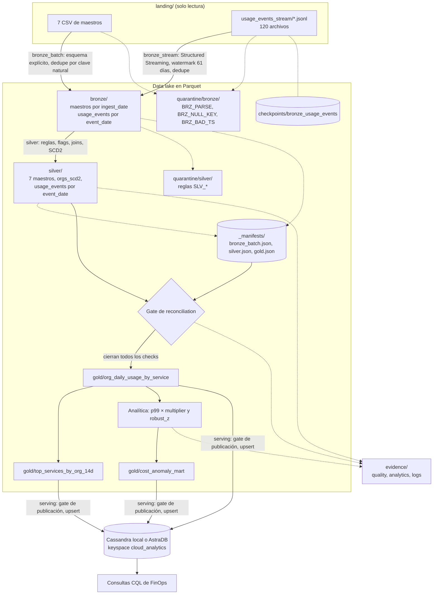
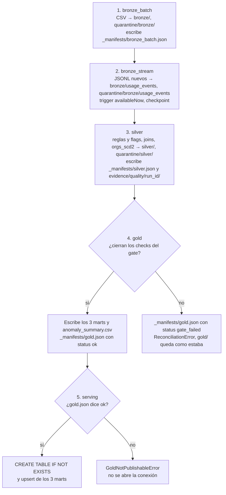

# Arquitectura

Versión 2, 2026-11-16. Reemplaza a la Figura 1 del informe de la entrega 1 y muestra lo que está implementado, no lo planeado. Las rutas son relativas a `DATALAKE_PATH` (`data/datalake/` en el repo).

## Arquitectura implementada

Las flechas punteadas son lo que se escribe como control o evidencia: rows rechazadas, conteos de cada step (`_manifests/`), el checkpoint del stream y los reportes de `evidence/`. El gate compara Landing, `bronze/`, `quarantine/bronze/`, `silver/` y `quarantine/silver/` contra los manifests antes de escribir Gold ([`DECISIONS.md`](../../DECISIONS.md), D-01).

## Flujo de los steps

`./infra/run.sh run` corre los cinco steps en este orden, con un mismo `run_id`. Si uno falla, la corrida se corta.

`serving` también se puede correr solo (`./infra/run.sh run serving`); por eso vuelve a mirar `gold.json` antes de publicar.

## Cambios respecto de la Figura 1 del informe

- **Quarantine por capa.** La figura tenía una sola quarantine alimentada desde Bronze. Ahora Bronze escribe en `quarantine/bronze/` y Silver en `quarantine/silver/`, con `_rule_id`, `_quarantine_reason` y `_raw` (D-16).
- **Gate de reconciliation y manifests.** Entre Silver y Gold hay un control que antes no estaba en el diagrama: cada step deja sus conteos en `_manifests/` y `gold` no escribe nada si no cierran (D-01).
- **Gate de publicación.** `serving` solo publica si `_manifests/gold.json` dice `ok` (D-09).
- **Checkpoints a la vista.** El checkpoint del stream es una zona más del lake.
- **Analítica sobre Gold, no después de Cassandra.** La detección de anomalías corre dentro del step `gold` sobre el mart diario y su resultado es un mart más (`cost_anomaly_mart`) que se publica en Cassandra. Silver sigue marcando picos por evento (`is_cost_anomaly`). Detalle en [analitica.md](../analitica.md).
- **Recálculo completo.** Silver y Gold se recalculan enteros en cada corrida, no por fecha afectada (D-15), y la carga a Cassandra es completa por upsert, no por fecha.
- **Stream por corrida.** `bronze_stream` usa `availableNow`: procesa los archivos nuevos y termina, en vez de quedar corriendo (D-11).
- **Gold con tres marts.** `revenue_by_org_month`, `tickets_by_org_date` y `genai_tokens_by_org_date` todavía no están ([backlog](../backlog.md)).
- **Consumo.** Por ahora son las consultas CQL que se corren con `./infra/run.sh query` y `queries`; no hay dashboards.
- **Evidencia.** Cada step deja logs, reportes de calidad y analítica en `evidence/`.
